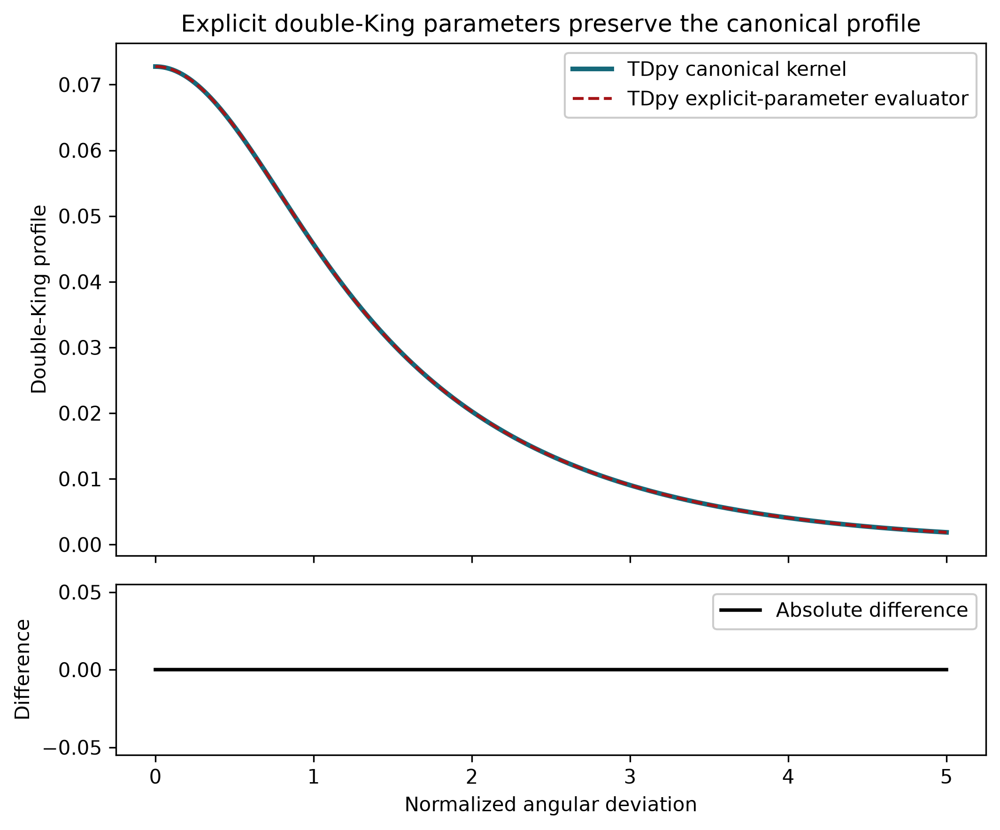
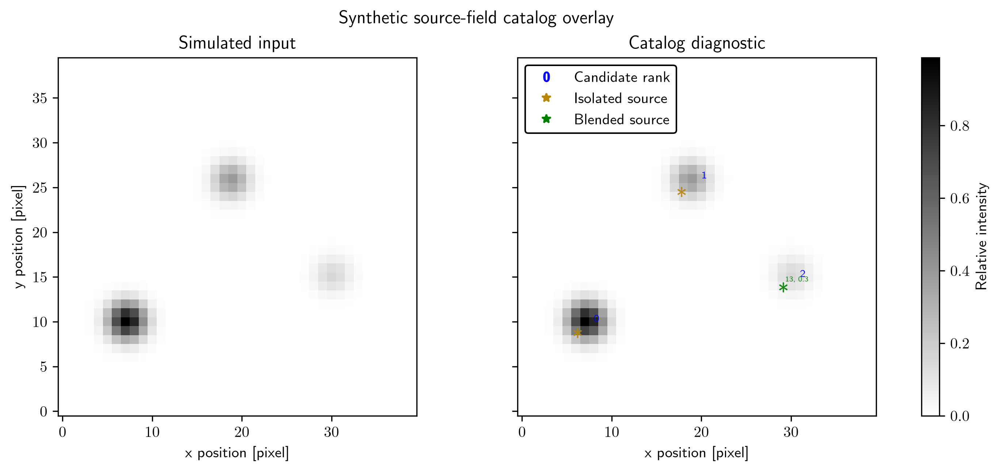
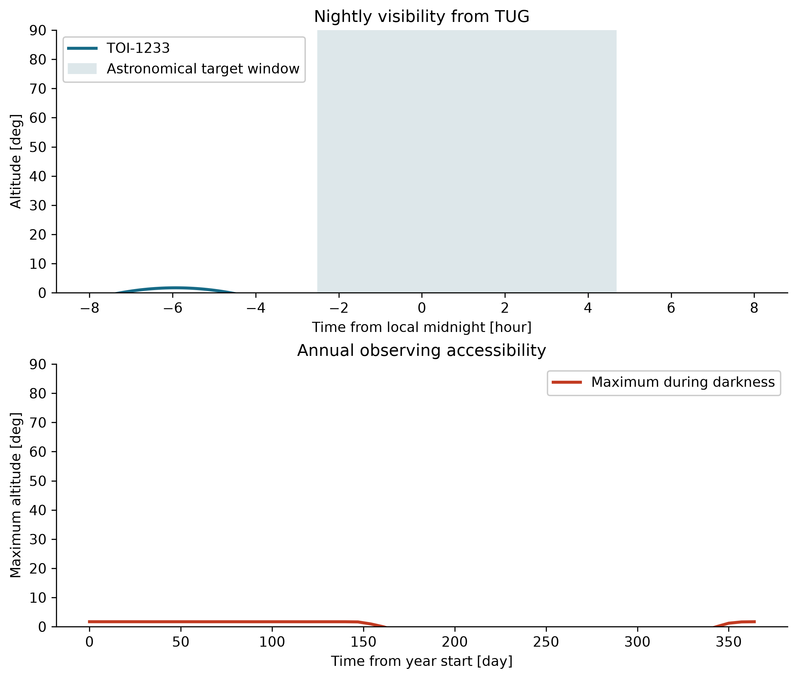
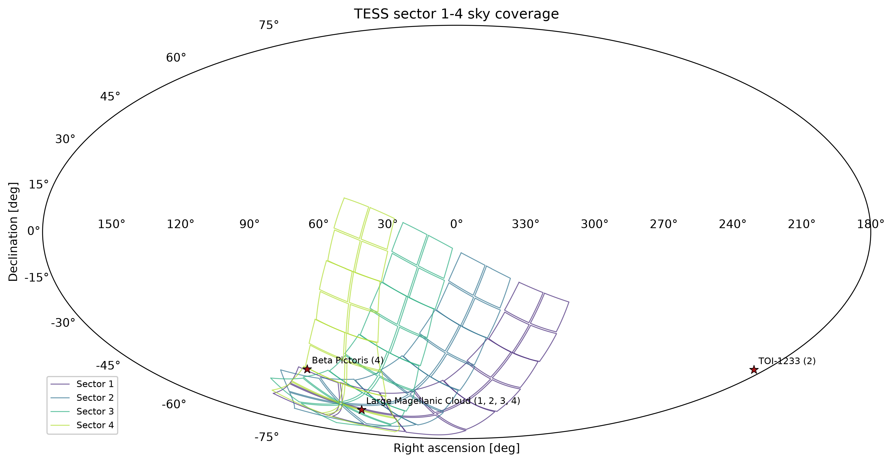
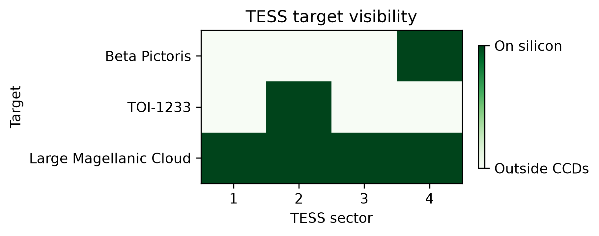
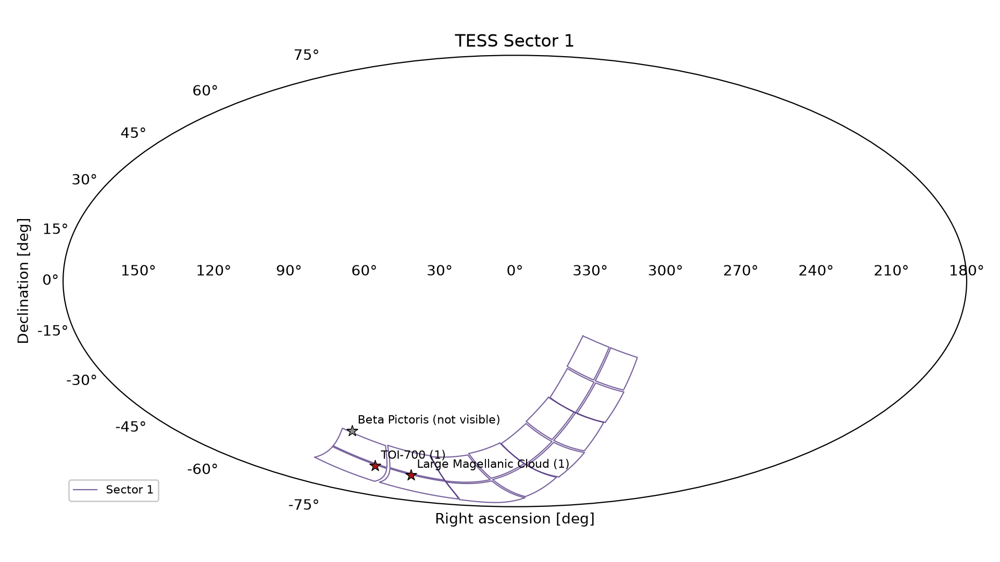
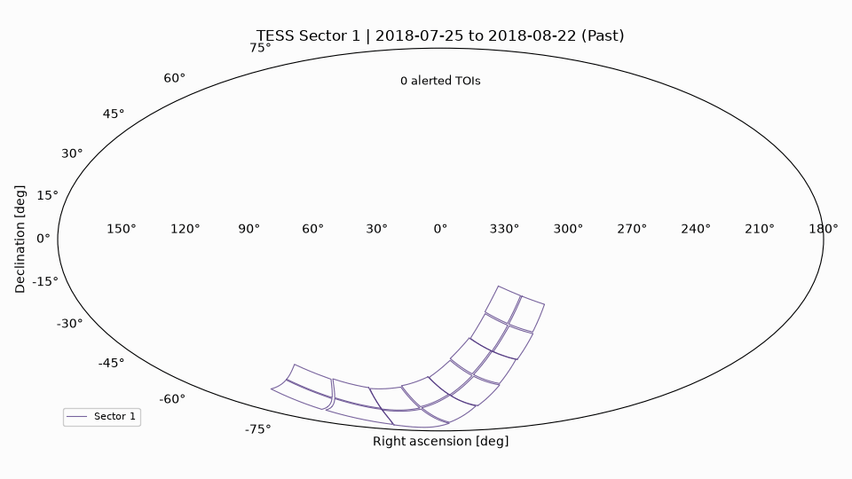
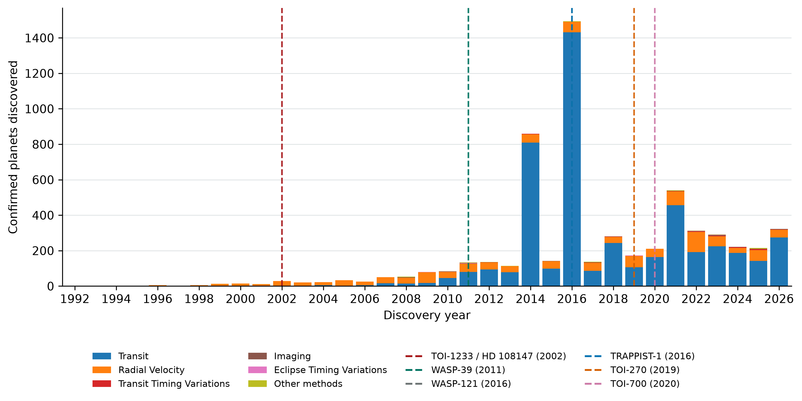
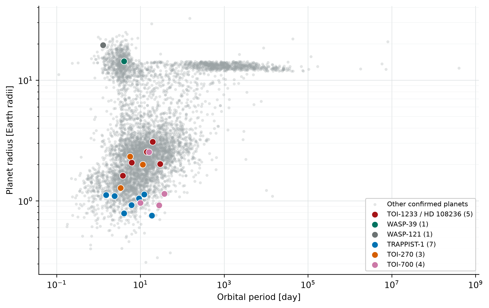

# TDpy numerical and visualization utilities

## Purpose

I use TDpy for the small, recurring jobs that sit between an astrophysical idea and a result I can inspect. It handles numerical arrays, plots, catalog annotations, and data paths. I keep the shared helpers here so a new analysis can spend its lines on physics rather than reimplementing a weighted quantile.

Use a function in a short calculation, or let the larger analysis packages call it. The same numerical definitions should apply either way.

## What it provides

The shared tools cover:

- environment-based filesystem and data-path normalization
- reusable plots for population and catalog analyses
- self-contained interactive HTML figures through `tdpy.plotting.save_bokeh_html` and the optional `bokeh` extra
- numerical support for array handling, weighted medians and quantiles, and quantiles from gridded probability densities
- lightweight visualization utilities used across time-domain and catalog workflows
- consistent output directories for figures and intermediate calculations

## Scientific utilities

- build periodic-event timing and overlap reports with `tdpy.astro`
- calculate bulk densities, Roche distances, escape velocities, equilibrium and irradiation temperatures, interval contrasts, and atmosphere forecasts with `tdpy.exoplanet`
- construct normalized NIRSpec calculations with `tdpy.pandeia`
- evaluate normalized line profiles, power-law/curved/cutoff continua, blackbody flux and luminosity, and AXIS transmission with `tdpy.spectral`
- run labeled, fail-fast command sequences with `tdpy.workflow`.

`tdpy.exoplanet.energy_limited_mass_loss` divides absorbed XUV power by the
planet's binding energy per unit mass and returns an Astropy mass-loss-rate
quantity. Supply mass, radius, and incident XUV flux with physical units.
Heating efficiency, absorption radius, and the dimensionless Roche factor
are explicit assumptions. The absorption radius defaults to the planet radius
and the Roche factor to unity. Arrays broadcast, while masked observations
and nonphysical inputs are rejected. This static energy budget does not evolve
an atmosphere, calculate radiative cooling, or predict a population radius valley.
The energy-limited approximation and Roche correction are discussed by Erkaev
et al. (2007), *A&A*, 472, 329, DOI `10.1051/0004-6361:20066929`.

## Profiles and catalog access

`tdpy.evaluate_psf_profile` evaluates Gaussian, single-King, and double-King profiles from explicit parameters, with optional spherical-angle normalization over the supplied grid. The separate `tdpy.retr_psfn` interface remains available for existing workflows. TDpy also provides spectral, radial-velocity, limb-darkening, photometric-noise, and population-subsetting functions.

```bash
python examples/psf_profiles/double_king_profile.py --typefileplot png
python examples/psf_profiles/double_king_profile.py --typefileplot png --bokeh
```



The example uses dimensionless core and tail widths of 0.8 and 1.7, indices of 2.2 and 3.4, and a core fraction of 0.35. It compares the explicit evaluator with the canonical kernel and reports zero difference for those inputs.

`tdpy.mast` provides structured MAST requests, TIC column retrieval, TESS observation queries, and target-coordinate resolution. `tdpy.retr_dictfluxband` integrates blackbody surface flux over approximate top-hat passbands, or optional `sncosmo` LSST bandpasses. The historical `Bolometric` option spans only 0.1 to 10 microns. `tdpy.retr_dictxraystar` retains the inherited blackbody-plus-assumed-X-ray-fraction calculation, with assumed excess fractions of $6\times10^{-7}$ or $10^{-4}$ below 4000 K. Those fractions are model assumptions, not measured X-ray luminosities.

Pergamon handles catalog adapters and population synthesis. The original MIT notice is in `LICENSE.Nicomedia`.

## Installation

Install from the repository root:

```bash
cd tdpy
python -m pip install -e .
export TDPY_PATH=/path/to/tdpy
```

Install `python -m pip install -e '.[bokeh]'` to enable `tdpy.plotting.save_bokeh_html` and the maintained examples' interactive HTML outputs.

`TDPY_PATH` identifies the repository root. Runtime inputs belong under `data/` and generated pipeline outputs belong under `visuals/`. Both directories are ignored by Git. Other repositories follow the same `<REPOSITORY>_PATH` root convention.

## Console output

TDpy and pipelines built on it, including PCAT, Miletos, and Ephesos, print nothing by default, including progress bars and numerical warnings. Set `export TDPY_VERBOSITY=1` to enable progress messages, file narration, and warnings.

## Quick example

The synthetic example annotates a three-source catalog on a Gaussian image:

```bash
python examples/catalog_overlay_diagnostic.py --typefileplot png
```



This produces a two-panel figure showing a deterministic Gaussian source field before and after catalog annotation. The three sources have mean magnitudes of 11, 12, and 13 mag. Two are isolated and one is labeled as blended. These are clearly labeled simulated inputs rather than observational evidence.

## Catalog annotation

Compare the plain image with the annotated view to inspect the supplied positions, magnitudes, blend labels, and label placement. That makes it easier to catch an annotation that has wandered away from its source.

## Core plotting utilities

`tdpy.plot_catl()` overlays source positions, magnitudes, and annotations on image fields. PCAT draws corner plots of parameter samples and provides posterior sampling, including `pcat.fixed.sample_posterior`.

These routines can be called directly wherever an analysis needs consistent catalog annotations.

## Posterior sampling

TDpy provides numerical transforms and independent random variate generators such as `samp_gaustrun`, `samp_powr`, and `samp_dpow`. These functions draw directly from specified distributions and do not run Markov chain Monte Carlo (MCMC). PCAT provides posterior-sampling interfaces for fixed-dimensional inference and transdimensional catalog models.

- `pcat.sampling.sample()` for transdimensional catalog inference
- `pcat.sampling.sample_fixed()` for a fixed-dimensional model
- `pcat.sampling.sample_fixed_chains()` for multiple fixed-dimensional chains
- `pcat.sampling.sample_posterior()` for the dictionary-style interface

## Nightly and annual target visibility

`tdpy.astro.run_target_visibility_diagnostic()` computes a target's altitude and the Sun's altitude through one night, then samples the target's maximum altitude during darkness across a year. The output plot and arrays work for any observatory latitude, longitude, height, and target coordinates. The maintained [TOI-1233 example](examples/target_visibility/TargetVisibility.ipynb) uses the TUBITAK National Observatory and needs no network access. From the TDpy repository root, run:

```bash
python examples/target_visibility/run.py --target TOI-1233 --observatory TUG
python examples/target_visibility/run.py --target TOI-1233 --observatory TUG --bokeh
```

Install `python -m pip install -e '.[bokeh]'` and add `--bokeh` to write the interactive companion as `examples/target_visibility/visuals/target_visibility_toi-1233.html`.



## TESS sky coverage and visibility

`tdpy.tess` converts the Transiting Exoplanet Survey Satellite (TESS) mission pointing and detector World Coordinate Systems from `tesswcs` into reusable sky products. It provides:

- `tess_sector_footprints()` for the 16 camera/CCD boundaries in one sector;
- `target_is_visible()` and `tess_target_visibility()` for on-silicon checks;
- `plot_tess_sector_map()` and `plot_tess_sector_sequence()` for full-sky maps;
- `plot_tess_visibility()` for target-by-sector coverage matrices; and
- `animate_tess_sectors()` for fixed-frame full-sky GIFs over time.

Run the maintained example to draw quick static maps of Sectors 1--4 and a dated animation of all standard sectors 1--134:

```bash
python examples/tess_visibility/tess_visibility.py --sectors 1 2 3 4
```









The inputs are integer sector numbers and optional named International Celestial Reference System coordinates in degrees. The example highlights the real position of TOI-1233 and also marks Beta Pictoris and the Large Magellanic Cloud. Dates for Sectors 1--121 come from the `tesswcs` pointing table. Provisional dates and pointings for Sectors 122--134 come from [NASA's TESS observing schedule](https://heasarc.gsfc.nasa.gov/docs/tess/sector.html), recorded on October 1, 2026. `tesswcs` predicts camera geometry for future sectors from those published pointings. Frames distinguish past, in-progress, and planned sectors as of the rendering date. These markers illustrate sky coverage and do not represent new observations. Each target is transformed through all 16 sector CCD World Coordinate Systems and is visible only when its pixel coordinate falls on silicon.

The second animation shows the 8,148 TOI candidates in the [ExoFOP TESS TOI table](https://exofop.ipac.caltech.edu/tess/view_toi.php), using its **Date TOI Alerted (UTC)** and sky-position columns as downloaded on October 1, 2026. Each candidate first appears in the sector frame whose end date reaches its alert date. Multiple candidates around one star overlap at the same sky position. TOI-1233 receives a separate red marker beginning with its 2019-08-26 alert. Future frames retain the TOIs already alerted as of the render date and do not imply future discoveries. The compact [TOI snapshot](examples/tess_visibility/toi_alerts.csv) makes offline reruns reproducible. Use `--refresh-tois` to download an updated ExoFOP table.

Static figures are written directly under `examples/tess_visibility/visuals/`. The example also writes one map per requested static-map sector. Runtime and memory scale with the number of animated sectors. Use `--animation-sectors 1 2 3 4` for a short development run. The footprint boundary follows nominal detector geometry in `tesswcs`. Future pointings remain provisional, and the maps do not model scattered light, data-quality masks, cadence availability, or target-specific postage-stamp allocation.

## Exoplanet discoveries and target systems

The [`exoplanet_discoveries` example](examples/exoplanet_discoveries/run.py) plots confirmed planets from [NASA's Exoplanet Archive](https://exoplanetarchive.ipac.caltech.edu/), downloaded on October 11, 2026, and bundles the queried rows for offline reruns. TOI-1233 is listed in the archive under its host-star name, HD 108236. It is highlighted alongside WASP-39, WASP-121, TRAPPIST-1, TOI-270, and TOI-700 in a discovery timeline and a period-radius comparison. The timeline separates discoveries by method and marks each selected system's first listed discovery year.

Run the example from the TDpy repository root with:

```bash
python examples/exoplanet_discoveries/run.py
```

Add `--refresh-data` to query NASA's Exoplanet Archive again.





## Data paths

TDpy normalizes environment-backed input and output paths with:

- `retr_pathbase()`
- `retr_pathenv()`
- `ensr_path()`
- `retr_path()`

These functions resolve data directories and create requested output directories without workstation-specific absolute paths.


